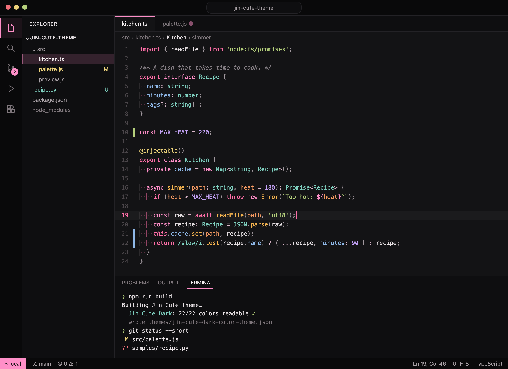
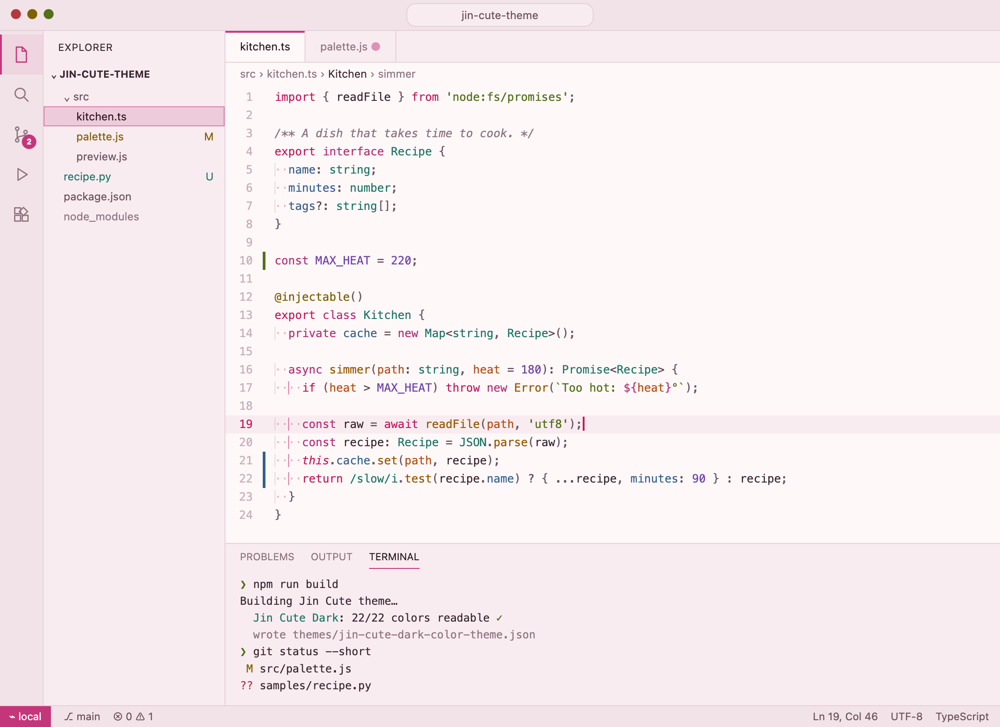

# Jin Cute Theme

A cute pink color theme for VS Code, in two flavors:

- **Jin Cute Dark**: true black backgrounds with pink accents
- **Jin Cute Light**: a soft blush background with deeper pinks





## Highlights

- **Black, not brown or blue-gray.** The dark editor is `#131315`, and the title and activity bars are a deeper `#09090a`.
- **Pink where it counts.** The active tab, activity bar, selections, badges, status bar, cursor and keywords are pink. Functions stay amber, strings green, types teal and properties blue, so code is easy to scan.
- **Readable.** Every code color meets a 4.5:1 contrast ratio against the editor background, and comments meet at least 3.5:1.
- **Complete.** Covers the whole workbench, the integrated terminal's 16 colors, git decorations, diff and merge views, bracket pair colors and semantic highlighting from language servers (TypeScript, Python, Rust and more).

## Install

1. Open the Extensions view (Cmd+Shift+X on Mac, Ctrl+Shift+X on Windows/Linux).
2. Search for **Jin Cute Theme** and click **Install**.
3. Open the Command Palette (Cmd+Shift+P / Ctrl+Shift+P), run **Preferences: Color Theme**, and pick **Jin Cute Dark** or **Jin Cute Light**.

Or install from the command line:

```bash
code --install-extension siveing.jin-cute-theme
```

## Recommended settings (optional)

The theme is designed for a thin pink line cursor that glides and pulses, faint dots in the indentation, and a pink line joining the brackets around the cursor. To get that look, add these to your `settings.json`:

```json
{
  "editor.cursorStyle": "line",
  "editor.cursorWidth": 2,
  "editor.cursorBlinking": "expand",
  "editor.cursorSmoothCaretAnimation": "on",
  "editor.smoothScrolling": true,
  "editor.renderWhitespace": "boundary",
  "editor.guides.bracketPairs": "active",
  "editor.bracketPairColorization.enabled": true
}
```

## Rounded corners (optional)

VS Code themes can only change colors. If you'd like rounded tabs, pill-shaped file selections and rounder popups, there's a companion stylesheet, [`ui/rounded.css`](https://github.com/siveing/jin-vscode-theme/blob/HEAD/ui/rounded.css), that you can load with the [Custom CSS and JS Loader](https://marketplace.visualstudio.com/items?itemName=be5invis.vscode-custom-css) extension. The loader edits VS Code's own files, so VS Code will show an "installation appears to be corrupt" notice, and you'll need to reload the CSS after each VS Code update. Setup steps are in [DEVELOPMENT.md](https://github.com/siveing/jin-vscode-theme/blob/HEAD/DEVELOPMENT.md#rounded-corners).

## Palette

| Role | Dark | Light |
| --- | --- | --- |
| Editor background | `#131315` | `#fff8f9` |
| Text | `#e6e0e3` | `#3b2530` |
| Accent (pink) | `#ff8fc8` | `#c4367a` |
| Cursor and control flow (hot pink) | `#ff6fa8` | `#c41a5c` |
| Functions (amber) | `#f5b450` | `#975b00` |
| Strings (green) | `#b5d07c` | `#527118` |
| Types (teal) | `#7fd1c0` | `#1c7465` |
| Properties (blue) | `#8fb8e8` | `#34608c` |
| Numbers and constants (lavender) | `#c3a2f5` | `#7345ad` |

## Feedback

Found a color that's hard to read, or a language that doesn't look right? [Open an issue](https://github.com/siveing/jin-vscode-theme/issues). A screenshot and the output of **Developer: Inspect Editor Tokens and Scopes** help a lot.

## License

[MIT](https://github.com/siveing/jin-vscode-theme/blob/HEAD/LICENSE)
